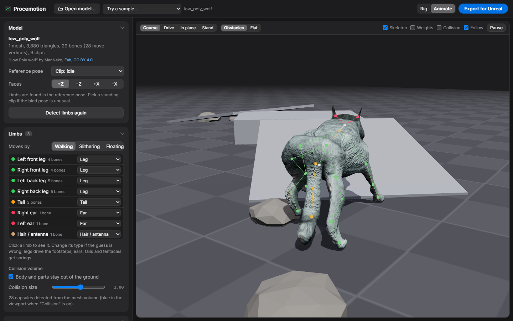

# Procemotion

Procedural, terrain-aware animation for creatures, for Unreal Engine 5.8. Runs in the browser; files stay on your computer.

**Use it online:** https://tallavie.github.io/Procemotion/ · [the app](https://tallavie.github.io/Procemotion/app/) ·
[how to use it](https://tallavie.github.io/Procemotion/guide/)

Open a rigged creature (GLB, GLTF, FBX, OBJ) and Procemotion finds its legs, wings, tails and ears, then makes it
walk, gallop, fly and slither over uneven ground, with every foot landing on what is under it. Bake the moves into
clips for any engine, or export a script that builds the live procedural rig in Unreal Engine. Four free sample
creatures come with it (*Try a sample…*), each with a link of its own: `app/?demo=wolf`, `spider`, `snake`,
`dragon` (`&mode=rig` opens the Rig view, `&fly=1` starts the dragon in the air).

**Run it yourself:** with [Node.js](https://nodejs.org) installed, `npm install` then `npm run dev`, and open
http://localhost:5184/app/ (on Windows, double-click `start.bat`). `npm run build` writes the site (home page,
`app/`, `guide/`) to `dist/`; every push to `main` publishes it to GitHub Pages (`.github/workflows/pages.yml`).
The guide's clips are recorded from the running app with `node tools/record-guide.mjs`.

**Licence:** GPL-3.0 (`LICENSE`). The sample creatures are by ManNeko, Bestgameassets, DaVe inc. and StudioGreen,
from Fab, under CC BY 4.0; see `THIRD_PARTY.md` for them and the libraries used.

The rest of this file explains how it works.

## What it does

1. **Finds the limbs** of any skeleton from its shape (bone names are only hints): legs (any number, including 3 or 6),
   arms, wings, tails, ears, tentacles, hair/antennae, jaws. Each limb is colour-coded and you can change its type.
2. **Adds bones** to parts that have none (ears, tentacles, hair, a tail), on rigged models too: only the new part is
   re-weighted. Click along the part on the model, or let *Find unrigged parts* propose chains. Mirroring is automatic.
3. **Rigs models with no skeleton**: pick a body plan (two legs, four legs, bird, snake, floating), drag the joints, bind.
4. **Moves it procedurally** over a test course (rocks, a step, ramps, stairs): footsteps for any number of legs, feet
   placed on the ground they land on, the body following the slope, springy ears/tails/tentacles, slithering, floating,
   flying, and actions (bite, charge, swipe, stomp, tail whip, roar, gust, hit, faint, jump, happy, look around).
5. **Bakes** clips (in place, flat ground, seamless loops) and **exports** for Unreal.

## Classifying bones by hand (Rig view, right panel)

For a model the detection gets wrong. **Bone classes** (right side of the Rig view) starts from what was detected:
pick a type (Leg, Arm, Wing, Folded wing, Tail, Ear, Tentacle, Hair / antenna, Jaw), then drag a box over its
joints in the view - joints hidden behind the body count too, and the skeleton is shown on top.
**Select: Single / Multi** - Single takes one joint per click, Multi boxes many.
**+ Add to existing class** adds joints to a part that is already there (a wing that missed a joint): to the part
selected in the list, or else to the part the joints join onto; pieces of that type which the added joints connect
up again are merged back. **Shift** does the same for the selected part, **Alt** (or *Remove*) takes joints out of
their part; Esc stops; right-drag still turns the view. *Head* and *Pelvis* are picked with one click.

- Each connected group of boxed joints becomes one part, so one box over both legs makes two legs; the side comes
  from the symmetric bind pose (L / C / R on each row to change it), and legs are named front / middle / back.
- A limb's chain runs through a fork only into a clearly dominant branch; equal branches (toes, fingers) hang off it.
  Springy parts (tail, ear, tentacle, hair) follow the branch that carries straight on, and each branch splitting
  off becomes a part of its own (several tails from one root).
- Single joints caught in a box next to real parts are left as they were; body joints (the head - pelvis line) are
  never taken; small gaps in a chain are filled.
- Every change is saved in this browser for the model (by its bone names) and comes back when it is opened again;
  *Auto-detect* forgets it. *Export / Import JSON* moves a classification between computers. Ctrl+Z undoes.

## How the detection decides

- **Wing or arm.** A long part reaching out sideways is a wing when its skin is a flat membrane, an arm when it is a
  round tube (thinnest / middle spread of the vertices it moves, in the bind pose). Bone names are only the fallback,
  so a bird's wing built on bones named *Finger* is still a wing.
- **Legs come in mirrored pairs:** the twin of a leg (same build, mirrored place) is a leg too, even when a hovering
  reference pose holds it off the ground.
- **Parts growing off a leg** (a flame, a fin): at a fork in a leg the chain continues into the branch that reaches
  the ground, and the other branch becomes a part of its own with its spring.
- **Small parts on the back** count as wings only when their skin is flat and they come in a mirrored pair; round
  lumps and single plates stay springy body parts.
- **Six legs (insects)** pair up front to back and walk in alternating tripods. Insect legs arch up from the hip and
  sprawl out sideways, so the foot is found even when no joint comes near the ground, and sprawled legs take shorter,
  quicker steps instead of overstretching.

**Springs** (ears, tails, hair, plates) react to the body speeding up, slowing down and turning, not to steady speed.
Short parts are stiffer, and every part has a swing limit by type. **Four-joint legs** (hip, knee, heel, toe) bend
the knee from the hip-knee-heel triangle, so a hind leg's heel points back while its knee points forward.

## Export → Unreal Engine 5.8

*Download for Unreal* gives three files:

- `name.glb` and/or `name.fbx` (Export → Model file): mesh, skeleton (with any added bones) and clips. Drag either
  into the Content Browser. The FBX is binary FBX 7.4 in cm, Y up, with the textures embedded, one take per clip and a
  first take `ReferencePose`: UE's FBX import takes the skeleton's reference pose from the first frame of the first take
  (not from the bind pose), so that take holds the bind pose. UE makes one Skeletal Mesh from the FBX (the GLB gives one
  per mesh part) and one Anim Sequence per take.
- `name.procemotion.json`: limbs, foot sets and every setting, in cm.
- `name_Procemotion_UE.py`: builds the runtime rig. Enable the **Locomotor** plugin (Experimental, ships with UE) and
  the Python Editor Script Plugin, select the imported Skeletal Mesh, then *Tools > Execute Python Script*.

The script creates `name_Procemotion`, a Control Rig made only of nodes that ship with UE:
`Locomotor` (footsteps + ground collision + pelvis) → one `Basic FABRIK` per foot → `Chain Harmonics` per ear, tail,
tentacle and hair. In your Anim Blueprint: *pose → Control Rig (name_Procemotion) → Output Pose*. Move the character
with CharacterMovement (in-place animation); the rig steps by itself and puts the feet on whatever is below them.

It also creates **`BP_name_Procemotion`** next to the rig: drag it into a level and press Play. It walks a circle (a
Rotating Movement component turning about a pivot beside it, so it always faces forward) with a Control Rig component
running the rig. Change speed and radius in its **Walk** component (Rotation Rate, Pivot Translation).

Set **UE import scale** in the Export panel to the scale you import with, so step heights and speeds come out right.

For walking creatures the exported model is re-bound in the reference pose (the standing pose Procemotion found the
limbs in), so that pose is the skeleton's reference pose in UE: some models are bound lying down, and the Locomotor
starts from the reference pose. Re-binding shifts blended areas a little in the model's own clips, so it is a
checkbox in Export, on by default only for creatures with legs.

**See-through models.** Some models mark every material as alpha-blended though nothing in them is transparent, so the
far side of the body shows through. On load, materials whose texture and vertex colours are fully opaque become solid,
alpha cut-outs use alpha testing, and only real translucency stays blended. The exported files carry the fixed
materials.

## Running: gallop

From about half speed, creatures with two or more legs blend from their walk into a gallop (Movement → When running):
the legs of each pair move almost together, front and hind pairs alternate half a stride apart, there is a moment with
every foot in the air, the back bends up and down and the body rocks. A creature with two legs bounds with both, and a
body lying on the ground gets a hump that runs back along it once per stride. Six legs or more run in their tripods
instead. The baked Run clip gallops. In UE the script builds a second rig, `name_Procemotion_Run`, where every foot is
a set of its own at its gallop phase, and `BP_name_Procemotion_Run`, which gallops round its circle. The up-down
bending of the back is in the baked clips, not in the UE runtime rig.

**On all fours.** A creature with two legs and two arms drops onto its hands when it gallops (Movement → *Gallop on
all fours*): the upper body pitches forward just far enough for the shoulders to reach the ground, the head turns back
up to look ahead, and the arms join the gait as front legs. Walking stays upright, and if the arms are too short to
reach the ground it keeps running upright. In UE the running rig does the same with an Offset Transform node and arm IK.

## Collision volume

Procemotion detects the creature's volume from the mesh: one capsule per bone, sized from the vertices that bone moves
(like a Physics Asset in UE). Turn on **Collision** in the viewport to see it; **Collision size** in the Limbs panel
scales it. The volume keeps the body out of the ground (the body rises over rocks, steps and slopes instead of sinking
in), and chains that lie on the ground in the reference pose (a long tail) keep their height over the local terrain,
so they bend over slopes and steps. The generated Control Rig does the same in Unreal: it traces the ground under every
body capsule and lifts the body by the deepest penetration, and aims ground chains so their joints keep their height.

## Smoother bends (more bones)

*Add bones → Smoother bends* splits every bone of a chain (a tail, a tentacle, the body, or the whole serpent body)
into 2–4 bones. The new bones have no rotation of their own and the children's position keys are corrected, so the
model's own clips play exactly as before, while the procedural motion and springs get more joints to bend with.

## Birds and winged creatures

The wings follow bird flight rather than a plain sine: each wing segment (upper arm, forearm, hand) gets its own
direction every frame. The downstroke takes longer than the upstroke, the outer wing lags the inner one, the elbow and
wrist fold on the upstroke, the tip draws a loop, and the wing twists. The body rises on each downstroke, the tail
pitches against the stroke, the creature banks in turns, take-off beats harder with the nose up, and landing flares.
**Flap + glide** (default) beats a few times and then glides with the wings held out. All of these are sliders in the
Flight panel, and every flight style bakes to a clip.

Some models have two pairs of wings: open ones for flying and folded ones for standing. When the model's own clips
hide a wing by shrinking its bone, Procemotion marks those wings as air-only and the limbs next to them as **Folded
wing**, and swaps the pairs on take-off and landing. You can also set **Folded wing** by hand in the Limbs list.

## Serpents

Long bodies without legs are posed as one chain that follows the path its head took: on the ground with the neck
raised, or (Flight → Fly) floating in the air with an up-down wave. **Ears in flight** (Flight panel): *Springy*,
*Flap* (beating like wings) or *Spread* (held open with a light flutter). Fins or other parts can be set to **Wing**
in the Limbs list to flap them too. In UE, serpents use the baked clips (Slither, Fly (serpent)); the generated rig adds
the springs for ears and hair, but the Locomotor is only used for legged creatures.

## Files

- `src/detect.js`: limb detection and default foot sets; `src/classify.js`: the Bone classes panel
- `src/autorig.js`: adding bone chains, automatic weights, templates, unrigged-part search
- `src/motion.js`: the procedural engine (mirrors the parameters of UE's Locomotor node)
- `src/actions.js`: procedural actions; `src/bake.js`: clip baking; `src/exporter.js`: GLB, config and UE script; `src/fbx.js`: binary FBX writer
- `src/terrain.js`: the test course; `src/ik.js`: FABRIK with bend direction; `src/main.js`: the app
